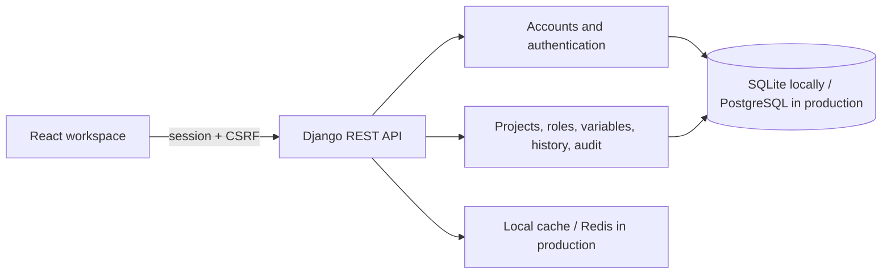

# EnvShare

EnvShare is a team workspace for managing application environment variables across Development, Staging, and Production. It provides role-controlled access, masked Sensitive values, encrypted version history, reviewed `.env` imports, and audit trails.

> **Status:** The application and its security controls have been verified locally, but EnvShare has not been deployed or certified for production. PostgreSQL, Redis, hosting, and recovery still require deployment-specific verification.

## Features

- Session-based authentication with CSRF protection, password hashing, login throttling, and authentication audit events.
- Private projects with four roles and backend-enforced permissions.
- Development, Staging, and Production environments with Standard and Sensitive variable classifications.
- AES-256-GCM encryption for Sensitive values and encrypted variable history, with separate Sensitive and Standard-history keys.
- Version history, comparisons, restoration as a new version, and deletion snapshots.
- `.env` import preview showing New, Update, and Unchanged entries before explicit confirmation.
- Email-bound, expiring team invitations using hashed, single-use tokens. Invitation email delivery is not implemented.
- Filterable, paginated audit logs for authentication, project access, and variable events. Sensitive contents are redacted.
- PostgreSQL configuration for production, Redis-backed shared caching, and liveness/readiness endpoints.

## Roles

| Role | Permissions |
|---|---|
| Owner | Full project control, including assigning Admins, managing all memberships, and deleting the project. The owner is the project creator. |
| Admin | Manage project data and invitations; manage Managers and Members. Cannot assign or manage the Owner or another Admin. |
| Manager | Create, edit, delete, import, and reveal variables; view audit history. Cannot manage membership. |
| Member | Read project variables and audit history. Sensitive values remain masked. |

Permissions are enforced by the backend; hiding a frontend control is not an authorization check. There are no separate role grants per environment.

## Technology and architecture

- **Frontend:** React, TypeScript, Vite, and Tailwind CSS.
- **Backend:** Python, Django, and Django REST Framework.
- **Local data:** SQLite.
- **Production data/cache:** Environment-configured PostgreSQL and Redis.

The browser communicates with the Django API using session cookies and CSRF tokens. Django owns authorization, persistence, encryption, audit events, and import confirmation. See [Architecture](docs/ARCHITECTURE.md) for data relationships, security boundaries, and concurrency behavior.



### Encryption keys

The three keys have separate purposes:

| Setting | Purpose |
|---|---|
| `DJANGO_SECRET_KEY` | Django signing and framework security. Legacy Standard history v2 records also have a compatibility dependency on the original value. |
| `ENVSHARE_ENCRYPTION_KEY` | Current Sensitive values, Sensitive history, and legacy v1 snapshots. |
| `ENVSHARE_HISTORY_ENCRYPTION_KEY` | New Standard history v3 snapshots. |

Encryption uses AES-256-GCM and authenticated context. The two EnvShare encryption keys must be Base64-encoded 32-byte keys, kept stable and backed up with the database. Local v2 history compatibility is preserved by a dedicated history key provisioned with the exact legacy HKDF-derived material; legacy records also have a read path using the current Django key. Key rotation and history re-encryption are not implemented. Never commit `.env` files or real keys. See [Backup and recovery](docs/BACKUP_RECOVERY.md).

### Security behavior

Sensitive values are masked in ordinary responses. Authorized reveal is audited before plaintext is returned. Standard current values are stored as plaintext; Standard history snapshots are encrypted. Import previews mask Sensitive values and require explicit confirmation. Authentication uses Django sessions and CSRF protection; login and registration are throttled. The health endpoints are `/health/live/` (process liveness) and `/health/ready/` (database and cache readiness).

## Local setup (Windows PowerShell)

Prerequisites: Git, Python supported by the pinned Django release, Node.js, npm, and PowerShell. The current local verification used Python 3.14.4, Node 24.18.0, and npm 11.16.0; these are observed versions, not minimum-version guarantees. PostgreSQL and Redis are not needed for SQLite development.

From the repository root:

```powershell
py -3.14 -m venv backend\.venv
.\backend\.venv\Scripts\python.exe -m pip install -r backend\requirements.txt
Set-Location frontend
npm.cmd ci
Set-Location ..
```

Configure the existing local environment and encryption keys before performing variable writes. Django reads `backend/.env` for variables not already supplied by the process; process environment values take precedence. Do not overwrite an existing key or generate a replacement for a database that already contains encrypted values. Follow the [Development guide](docs/DEVELOPMENT_GUIDE.md) for safe key setup and legacy history details. `.env` files are ignored by Git; keep real secrets out of tracked files and shell transcripts.

Start the backend from the repository root:

```powershell
.\backend\.venv\Scripts\python.exe backend\manage.py migrate
.\backend\.venv\Scripts\python.exe backend\manage.py runserver localhost:8000
```

In another PowerShell terminal:

```powershell
Set-Location frontend
npm.cmd run dev -- --host localhost --port 5173
```

Open `http://localhost:5173`. The local frontend API default is `http://localhost:8000/api`. Use a consistent hostname (`localhost` or `127.0.0.1`) across browser, CORS, and CSRF configuration.

## Common checks

From the repository root:

```powershell
.\backend\.venv\Scripts\python.exe -B backend\manage.py test
.\backend\.venv\Scripts\python.exe -B backend\manage.py check
.\backend\.venv\Scripts\python.exe -B backend\manage.py makemigrations --check --dry-run
```

From `frontend\`:

```powershell
npm.cmd test
npm.cmd run check
npm.cmd run build
```

Every Vite build requires `VITE_API_BASE_URL` to be a valid HTTPS API URL ending in `/api`, including local-mode builds. Use the real public API URL when building for production. The exact latest results and skipped tests are in [Project status](docs/PROJECT_STATUS.md).

## Production requirements and limitations

Production settings require PostgreSQL, Redis, explicit secrets and origins, and the guarded production WSGI or ASGI entry point. Operators must configure TLS termination, trusted proxy behavior, secure cookies, CORS/CSRF origins, frontend CSP headers, static hosting, monitoring, backups, and key recovery. The repository does not provision this infrastructure. PostgreSQL and Redis behavior has not been verified against live services, and local test success is not production certification.

Current limitations include no MFA, password reset, email verification, invitation email delivery, automated backups, key rotation/history re-encryption, browser end-to-end suite, or independent tamper-proof audit store. Losing a matching encryption key can make affected ciphertext unreadable; there is no application key recovery mechanism. See [Production deployment](docs/PRODUCTION_DEPLOYMENT.md), [Backup and recovery](docs/BACKUP_RECOVERY.md), and [Project status](docs/PROJECT_STATUS.md).
