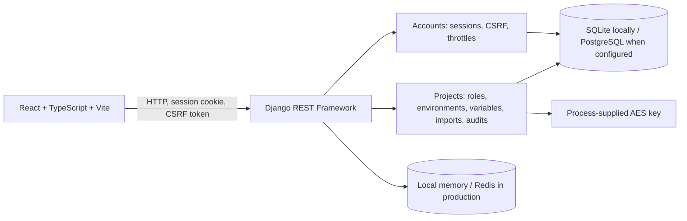

# EnvShare architecture

## System overview

The repository contains the application code and production configuration. It does not provision a hosting platform, database, Redis service, TLS termination, or frontend static host. PostgreSQL-specific behavior and shared Redis behavior remain unverified against live services.

## Components

- `frontend/src/` contains the React workspace, TypeScript API clients, import and audit screens, and styles. The client uses cookie credentials and obtains the CSRF token from the backend's JSON endpoint.
- `backend/accounts/` contains the custom `accounts.User`, registration/login/session endpoints, and authentication audit records.
- `backend/projects/` contains project membership, environments, variables, invitations, imports, encryption helpers, version history, audit events, and project-scoped API views.
- `backend/config/` wires Django settings, URLs, middleware, database/cache selection, health endpoints, error handling, and production startup checks.

## Data model and relationships

| Model | Relationship and purpose |
|---|---|
| `accounts.User` | Custom Django user; referenced by projects, memberships, invitations, variable/version events, and authentication audit events. |
| `Project` | Has a creator (the Owner), many `ProjectMembership` rows, invitations, environments, and audit/version records. |
| `ProjectMembership` | Joins a user to a project with Admin, Manager, or Member role; one row per project/user. The Owner is represented by `Project.creator`, not a membership row. |
| `ProjectInvitation` | Belongs to a project; stores normalized invite address, permitted role, token hash, expiry/use limits, and revocation state. |
| `Environment` | Belongs to a project; Development, Staging, or Production name is unique within that project. |
| `EnvironmentVariable` | Belongs to an environment; key is unique within the environment and value is Standard or Sensitive. |
| `EnvironmentVariableVersion` | Encrypted snapshot associated with project/environment/variable when those rows exist, plus ID/key/classification snapshots that retain context after deletion. |
| Audit events | `AuthenticationAuditEvent` tracks account events; `ProjectAccessAuditEvent` tracks project membership/invitations; `EnvironmentVariableAuditEvent` tracks variable operations. Nullable relations and snapshots preserve useful context when related rows are deleted. |

Project deletion cascades to its memberships, invitations, and environments. Variable and audit/version records use nullable links and retained snapshot fields where history is intended to outlive a live variable. Database migrations define the exact constraints and deletion rules.

## Authentication, sessions, and CSRF

Registration, login, logout, and current-user endpoints use Django sessions. Passwords are hashed with Django's configured Argon2-first hasher list. Unsafe requests use Django CSRF protection; the frontend fetches a CSRF token through `/api/auth/csrf/` and sends it in the CSRF header with session credentials.

Login requests are throttled at 5 per client IP per minute. Failed-password tracking separately allows 5 failures per normalized username in a 15-minute window before a 60-second cooldown. The username cache key uses an HMAC digest. Registration is limited to 5 requests per IP per hour. Production throttles depend on the configured shared cache; a live Redis multi-worker run has not been verified. Repeated cooldowns against a known username can temporarily deny that account access.

## Project membership and roles

The `Project.creator` is the Owner; owners are not represented as membership rows. `ProjectMembership` stores Admin, Manager, or Member and enforces one membership per project/user. Permission helpers and backend views enforce these rules; frontend visibility is not an authorization boundary.

| Role | Implemented project permissions |
|---|---|
| Owner | Full project and membership control, including assigning Admins and deleting the project. |
| Admin | Manage project data and invitations; assign/manage Managers and Members. Cannot modify the Owner or manage another Admin. |
| Manager | Manage variables, import, reveal Sensitive values, and view audit history. Cannot manage membership. |
| Member | View variables and audit history. Cannot modify variables or membership; Sensitive values remain masked. |

Projects create Development, Staging, and Production environment rows. Variable keys are unique within an environment. There are no separate role grants per environment.

## Variables and encryption

`EnvironmentVariable` stores a key, value, and Standard/Sensitive classification. Standard current values are plaintext in the database. Sensitive current values are encrypted using AES-256-GCM with a fresh 12-byte nonce and authenticated context containing the environment ID and key. Their key is supplied through `ENVSHARE_ENCRYPTION_KEY`, Base64-encoded to 32 bytes; it is not stored in the database.

Ordinary responses mask Sensitive values. Owner, Admin, and Manager roles have the reveal permission. A successful reveal writes a context-only audit event before returning plaintext; if the audit write fails, the API withholds the value.

Every variable version snapshot, including Standard values, is encrypted with AES-256-GCM and authenticated context binding project, environment, variable, key, version number, and classification. The three configurations are distinct: `DJANGO_SECRET_KEY` is Django's signing key; `ENVSHARE_ENCRYPTION_KEY` protects current Sensitive values and Sensitive/legacy v1 history; `ENVSHARE_HISTORY_ENCRYPTION_KEY` protects new Standard v3 history. The encryption settings are Base64-encoded 32-byte keys and must remain distinct.

Standard snapshots in the interim `v2` format use an HKDF-SHA256-derived AES key from the Django key, with 32-byte output, salt `envshare:history-key-derivation:v2`, and info `standard-variable-version-snapshots`. The reader first tries derivation from the currently configured Django key. If authentication fails, it tries `ENVSHARE_HISTORY_ENCRYPTION_KEY`, which can be provisioned with the legacy-derived material to preserve history across a later Django key change. Earlier v1 snapshots continue to use `ENVSHARE_ENCRYPTION_KEY`. The local history key was provisioned this way and is stored in ignored `backend/.env`; no secret value is documented here. Updates append versions; restoration adds a new version rather than overwriting prior history. Deletion appends an encrypted deleted snapshot before removing the live row. Snapshot metadata and ciphertext are retained internally, but deleted-variable history is not accessible through normal API endpoints. Back up all matching keys with the database. Key rotation and history re-encryption are not implemented; changing the Django key before v2 compatibility is secured can make old snapshots unreadable.

## Invitations

Owners and Admins can create invitations subject to role-assignment permissions. Invitations are email-bound, expire, and have a single use. Only a token hash is stored. Acceptance checks the authenticated account's email and atomically claims the use, creates membership, and records the access event under project-scoped write locking. The client removes the token fragment from the browser URL after processing. Invitation email delivery is not implemented; the application provides the link/token workflow but does not send mail.

## Imports and audit history

The `.env` importer parses key/value lines and provides New, Update, and Unchanged preview results before explicit confirmation. Preview confirmation is signed, short-lived, bound to the user/project/environment and input state, and written transactionally with variables and audit events. Sensitive values are masked in previews.

`AuthenticationAuditEvent`, `ProjectAccessAuditEvent`, and `EnvironmentVariableAuditEvent` record authentication, membership, and variable/import/reveal/version actions. Audit APIs are read-only, project-scoped, filterable, and server-paginated. Variable audit filters include action, source, actor, environment, variable, dates, and search. Sensitive values are redacted from audit changes. Project and variable history rows carry snapshots and survive deletion through nullable links; history for a deleted project or variable is not available through normal project-scoped APIs. These application records are not tamper-proof against database operators or an independent append-only export.

## Database and concurrency

SQLite is the default for local development and tests. `ENVSHARE_DB_ENGINE=postgresql` selects PostgreSQL using environment-supplied connection settings. Production settings reject SQLite, require PostgreSQL and Redis, and require encrypted PostgreSQL transport; `verify-full` is preferable where the provider's CA configuration allows it. Mutating workflows use `transaction.atomic()` and acquire a scope lock with a no-op `UPDATE` against the Environment or Project row before reading/modifying dependent records. PostgreSQL serializes competing writers through row locks; SQLite acquires its write lock early through the update. Constraint and operational errors are handled as safe conflicts where applicable. The project includes PostgreSQL concurrency tests. Five PostgreSQL-specific tests were skipped in the latest recorded local run because PostgreSQL was unavailable; SQLite test success does not verify PostgreSQL row-lock behavior.

The local cache is process-local memory. Production uses the configured Redis URL as Django's default cache for throttling and health checks. Redis multi-process behavior remains deployment-dependent and has not been integration-tested.

## Health and production security configuration

- `/health/live/` reports process liveness without dependency checks.
- `/health/ready/` checks the database and configured default cache and returns 503 if either fails.
- Production startup uses `config.production_wsgi:application` or `config.production_asgi:application`. These entry points require `DJANGO_ENV=production`; settings validate required secrets, host/origin, database, cache, and security configuration. The default WSGI/ASGI modules reject non-production server startup; `manage.py runserver` remains the local development path.
- Production enables HTTPS redirect, secure session and CSRF cookies, HSTS, structured logging with credential-shaped redaction, security headers, and optional trusted proxy scheme handling. The app trusts `X-Forwarded-Proto` only when explicitly configured; the proxy must overwrite client-provided values.
- Django middleware applies CSP to Django responses. A separately hosted React app needs its own CSP response header from the static host; the API header does not cover the frontend document.
- Vite validates the API URL for all build commands, regardless of Vite mode. It rejects non-HTTPS, credentials, query/fragment, reserved local names, and private/reserved IP literals. DNS routing and public reachability still need deployment validation.

These are implemented configuration controls, not proof of a secure deployment. TLS termination, host routing, Redis/PostgreSQL operation, frontend hosting, logging retention, monitoring, and recovery must be verified in the selected infrastructure. See [Production deployment](PRODUCTION_DEPLOYMENT.md), [Development guide](DEVELOPMENT_GUIDE.md), and [Backup and recovery](BACKUP_RECOVERY.md).
